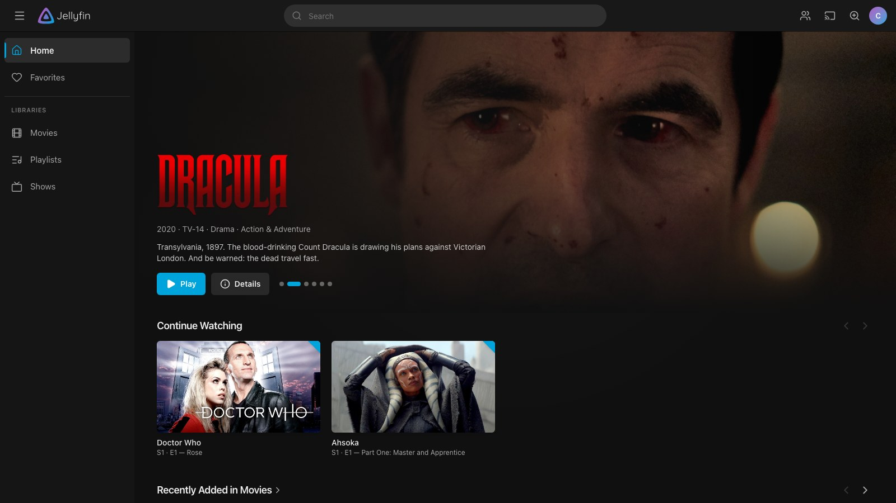
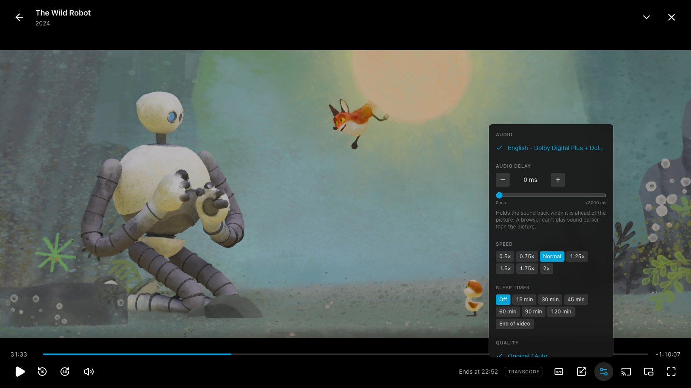
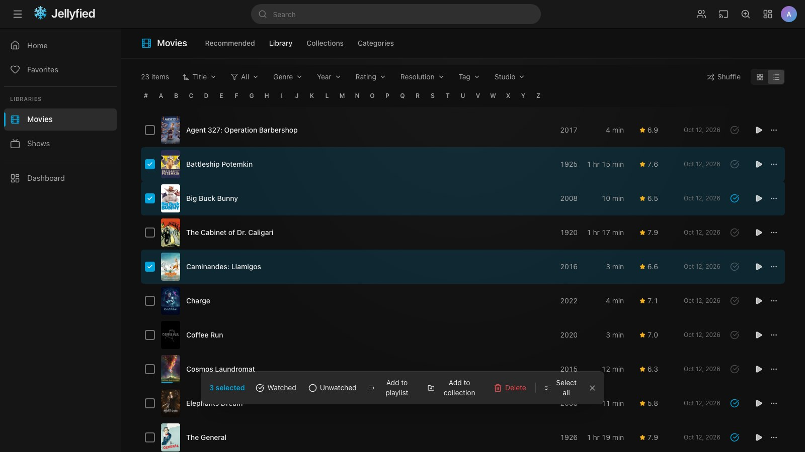
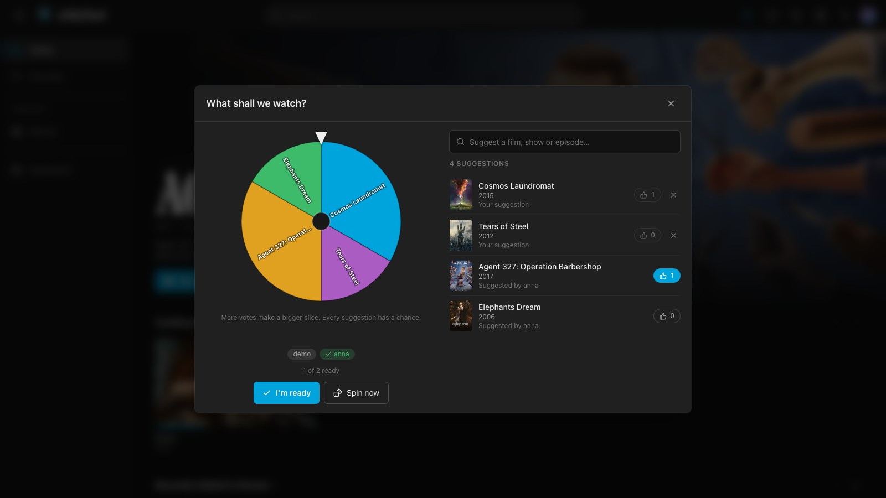
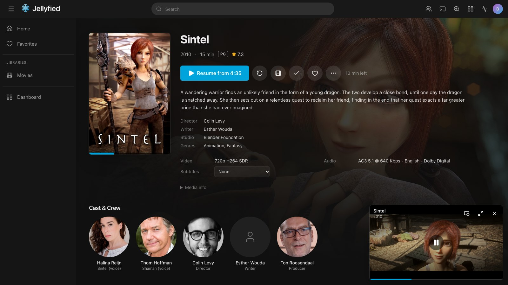
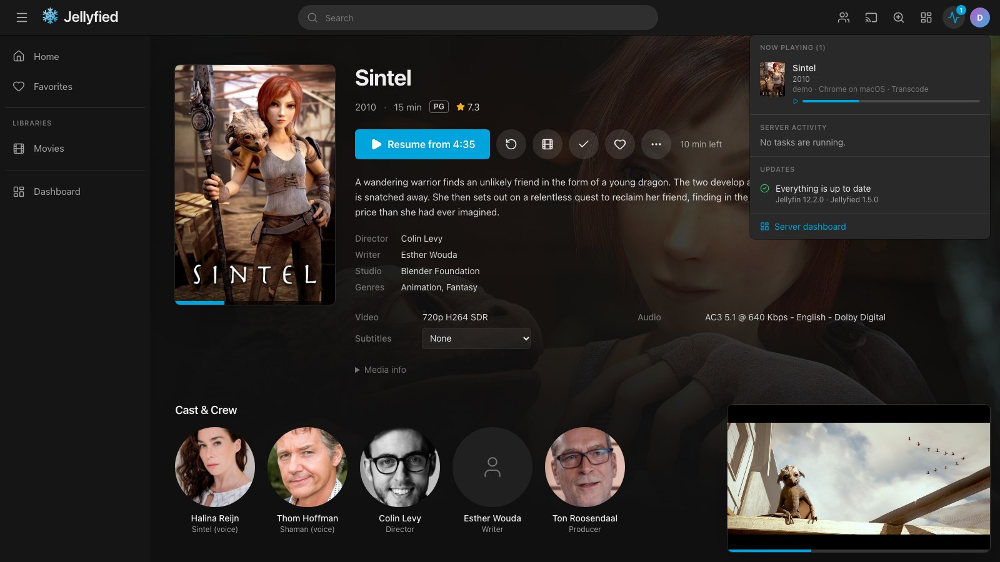

# Jellyfied

> [!NOTE]
> **This project is built entirely by AI.** All of the code, tests and documentation were written
> by an AI coding assistant, directed by the maintainer.
> No part of it was written by hand. Keep that in mind when you decide whether to run it, and
> please report anything that looks wrong.

A web frontend for an existing [Jellyfin](https://jellyfin.org) server, with a streaming-service style
layout and a full server dashboard for administrators. It runs as a
small nginx container. Your Jellyfin server is not modified: Jellyfied is just another client.



## Contents

- [Screenshots](#screenshots)
- [Features](#features)
- [Installation](#installation)
  - [Prebuilt image](#prebuilt-image)
  - [Docker Compose](#docker-compose)
  - [Building with Docker, without Compose](#building-with-docker-without-compose)
  - [Static hosting without Docker](#static-hosting-without-docker)
- [Documentation](#documentation)
- [Credits](#credits)
- [License](#license)

## Screenshots

| Player | Library, Recommended tab |
| --- | --- |
|  |  |

| Library grid | Library list, with items selected |
| --- | --- |
|  |  |

| Movie details | Show details |
| --- | --- |
|  |  |

| SyncPlay picker | Mini player |
| --- | --- |
|  |  |

| Server status (administrators) | Account settings |
| --- | --- |
|  |  |

The library in these pictures is made up of freely licensed and public-domain titles: the Blender
Studio open movies (Tears of Steel, Sintel, Big Buck Bunny, Cosmos Laundromat and others,
CC BY), Sita Sings the Blues (CC0), Pioneer One (CC BY-NC-SA) and silent films from before 1929.
The posters and descriptions are what the Jellyfin server fetched for them from
[TMDB](https://www.themoviedb.org); they belong to their owners.

## Features

**Browsing**
- Top bar with global search (type `/` to focus) and live results, collapsible library sidebar, account menu.
- Drag libraries in the sidebar to reorder them. The order is saved to your Jellyfin account, so it
  also applies to the home page and other Jellyfin apps.
- Home: a featured title at the top, Continue Watching (in-progress plus next-up episodes merged
  into one row), Continue Listening, and Recently Added per library. "Customise home" at the
  bottom of the page reorders (drag, or the arrow buttons) or hides the rows and the featured title.
- Libraries with tabs: Recommended / Library / Collections / Categories for movies and TV,
  Albums / Artists / Genres for music, and folder browsing for home videos, photos, books and mixed libraries.
  Sorting, infinite scroll, and filters for watched state, favorites, genre, year, age rating,
  resolution (4K / HD / SD), tag and studio. Genre, year, rating, tag and studio take several
  values at once (any of them matches).
- An A–Z bar in libraries sorted by title: a letter moves the list there, with the rest of the
  library still above and below it (the titles before it load when you scroll up). Sorting,
  filters and the A–Z bar stay at the top of the page while you scroll. A list view as a denser
  alternative to the poster grid.
- Built for large libraries: only the rows near the screen are kept in the page, posters are
  requested in the size the screen needs and show a blurred preview until they arrive, an
  item's page is fetched while the pointer rests on its card, and going back, or changing the
  poster size, returns to where you were in a list.
- Select several items (the tick on a card or row; shift-click for everything in between) to mark
  them watched or unwatched, add them to a playlist or collection, or delete them in one go.
- Pages update on their own: new media after a library scan, and watched state, favorites and
  resume positions changed on your other devices, appear without a reload.
- Live TV: the channels with what is on, a programme guide, what is airing now, and your
  recordings. Record a programme or every airing of a series from the guide, and see and cancel
  what is scheduled (needs the Live TV management permission).
- Photo slideshow, from a photo folder or from any photo (`Space` starts and pauses it).
- Adjustable poster size on every page (top-bar zoom button, or the slider in library views). The
  setting applies to every row and grid and is remembered.
- Detail pages for movies, shows, seasons, episodes, albums, artists, playlists, collections, people,
  genres and studios. Backdrop hero, ratings, cast & crew, extras, trailers, "More Like This", and
  version/audio/subtitle pickers.
- Shuffle button on folder-based libraries and folder pages. It plays everything below the folder,
  including subfolders.
- Unwatched corner badges, progress bars, watched toggles and favorites everywhere.
- "Remove from Continue Watching" in the menu of anything you have started, to clear its resume
  position.
- Add movies, shows and videos to a collection (new or existing) from their menu, and remove them
  again on the collection's page. Needs administrator rights or the collection-management permission.
- Playlists: "Add to playlist" in the menu of songs, albums, artists, movies, shows and episodes
  (to a new or an existing playlist). On a playlist's page, drag entries into another order, remove
  them, rename the playlist, or make it visible to all users.

**Playback**
- Video player that plays files directly when the browser supports them and lets the server
  transcode when it doesn't, switching over automatically if direct play fails. Transcodes use
  AV1 or HEVC where the browser decodes them and the server is allowed to encode them, and H.264
  otherwise, with 5.1 sound when the output has the channels for it.
- HDR and Dolby Vision files with an HDR10, HLG or SDR fallback play directly on screens that can
  show them.
- Audio track, subtitle, quality and playback speed (0.5×–2×) switching. Text subtitles
  (SRT/ASS/VTT, embedded or sidecar) and image subtitles (PGS/VobSub) are both supported.
- Styled subtitles (ASS/SSA) are drawn in the browser with their own fonts, colours, positions
  and effects, and PGS and VobSub (DVD) image subtitles are drawn in the browser too, so none of
  them makes the server re-encode the video.
- Resume, chapter markers and a chapter list to jump from, thumbnail previews on the seek bar
  (when the server has generated trickplay images), Skip Intro / Credits (when the server has
  media segments), Up Next with auto-play (honours the user's preference), keyboard shortcuts.
- Subtitle delay (earlier or later in 0.1 s steps) for every subtitle the browser draws, and
  subtitle appearance (size, colour, background, edge) for plain text subtitles. A switch under
  Account settings shows styled subtitles as plain text too, in the size and colour you chose.
- Touch controls: tap to show or hide the controls, double-tap the left or right side to skip,
  double-tap the middle for full screen, and swipe sideways to seek.
- Skip lengths of your choice (5 to 90 seconds, separately for back and forward), and a list of
  the keyboard shortcuts on `?`.
- Audio delay, to hold the sound back by up to 3 seconds when it is ahead of the picture. Both
  delays have a slider and step buttons in the player menus, as well as keyboard shortcuts.
- Aspect ratio and zoom: fit, fill (crop) or stretch the picture, force 16:9, 4:3, 21:9 or
  2.39:1, and zoom in up to 200%.
- Remembers the audio and subtitle track you pick for a show and uses it for the following
  episodes, matching by language and title, so it also works when episodes number their tracks
  differently. Follows the "Remember audio/subtitle selections" account settings.
- Playback info overlay ("stats for nerds"): play method, why the server is transcoding and what
  the transcoder is doing, source and player resolution, codecs, buffer and dropped frames.
- Sleep timer: pause after 15 to 120 minutes, or stop at the end of the current video.
- "Ends at" clock in the player controls, showing when the video will finish at the current
  playback speed.
- Picture-in-picture, from the player or the mini player, plus OS media controls (media keys,
  lock screen) for video.
- SyncPlay: create or join a group from the top bar and watch, or listen, together. Play, pause,
  seek and moving on to the next episode or song apply to everyone, and playback is kept in step across devices.
  A group can be open to everyone on the server or for the people you pick, who are asked in a
  popup whether to join. Its creator can delete it, which makes everyone in it leave.
- SyncPlay picker: in a group, everyone can suggest films, shows and episodes (from the picker's
  search or an item's menu) and give one vote to each of the others' suggestions. The suggestions
  make up a wheel where more votes mean a bigger slice. When everyone has said they're ready, or
  when the group's creator decides not to wait, the wheel spins on every member's screen and what
  it lands on starts for the whole group.
- Play on another device: pick any Jellyfin app that supports remote control (TV apps, another
  browser tab, …) from the top bar, and what you play is sent there, with a remote-control bar for
  pause, seek, volume and stop. Jellyfied tabs can be controlled the same way from other apps.
- Chromecast (Chrome, Edge and other Chromium browsers): pick "Chromecast…" in the same menu, or
  the cast button in the player to move the video you are watching to the TV.
- AirPlay (Safari): the AirPlay button in the player sends the video to an Apple TV or another
  AirPlay device.
- Mini player: press Back (or `Esc`) in the player and the video keeps playing in a small window,
  so you can browse and read media info while streaming. Click it to expand, or use its controls to
  pause or stop. Starting music pauses the video.
- Persistent music player bar with queue, shuffle, repeat, OS media keys and lyrics (timed ones
  follow the song, and a line can be clicked to jump there; Jellyfin 10.9 or newer).
- Instant Mix: start a queue of similar music from any song, album, artist, genre or playlist.
- Playback progress and watched state are synced with Jellyfin, so you can continue on any other
  Jellyfin app.
- Download a single file, or everything in a season, show, album, collection or playlist (one file
  after the other) from the item's menu, where the server allows downloads.

**Server dashboard (administrators)**
- Dashboard: active streams with transcode details and remote pause/stop/message, active devices,
  library counts, storage, running tasks, recent activity, scan/restart/shutdown.
- General settings, Users (create, delete, permissions, library access, passwords, and parental
  controls: highest allowed rating, unrated items, allowed and blocked tags, access schedule),
  Libraries (add with a server-side folder browser, rename, add/remove folders, scan, refresh metadata, remove),
  Transcoding (hardware acceleration, encoder settings, throttling, resume thresholds),
  Metadata (date added, NFO files, chapter images, trickplay), Networking, Branding (login
  disclaimer, and custom CSS and splash screen for Jellyfin's own web interface), Scheduled Tasks,
  Activity log, Devices, Plugins (installed, catalog and repositories, with a Configure link that
  opens the plugin's settings page in the Jellyfin web UI), Backups (create, list, restore),
  API keys and a Log viewer.
- Metadata editor ("Edit metadata" in an item's menu): titles, overview, dates, ratings, genres,
  tags, studios and external IDs; upload, delete or find artwork online; and Identify to match an
  item against the server's metadata providers again. For videos, a Segments tab lists the
  intro, credits, recap, preview and commercial markers the player offers to skip, and edits them
  when the server has the Intro Skipper plugin.

**Account**
- Quick Connect sign-in and authorization, profile picture, password, playback language and subtitle
  preferences, streaming quality per device, time display (24-hour by default, or 12-hour),
  subtitle appearance and interface colours (accent colour, from presets or any colour you pick,
  and background tone).
- Several accounts on one device: "Add another account" in the account menu keeps the current one
  signed in, and you switch between them from the same menu or the sign-in screen without typing
  a password again. The sign-in screen asks "Who's watching?" with everyone's picture: the
  accounts signed in on the device and the server's public users. An account can be given a PIN
  (Account settings) that is asked for before anyone switches to it on that device, and shows a
  lock there; while another account is in use, its sign-in is stored encrypted with that PIN.
- Your stats (account menu): time watched, films, episodes and song plays, your top genres, what
  you have rewatched and the last twelve weeks, worked out from your play state.
- Your preferences follow your account: colours, subtitle appearance, skip lengths, time display,
  the home page layout and the tracks remembered per show are the same in every browser you sign
  in to. This can be switched off under Account settings.

## Installation

Jellyfied needs a running Jellyfin server (10.9 or newer, 10.11 or 12 recommended) and Docker. You can
run the [prebuilt image](#prebuilt-image) or build the container from source with
[Docker Compose](#docker-compose).

### Prebuilt image

Images for amd64 and arm64 are published to the GitHub Container Registry:

```bash
docker run -d --name jellyfied -p 8080:80 \
  -e JELLYFIN_URL=http://192.168.1.10:8096 \
  --restart unless-stopped ghcr.io/charliegolfx/jellyfied:latest
```

Set `JELLYFIN_URL` to your Jellyfin server as reachable from inside the container (see the table
under [Docker Compose](#docker-compose)), then open `http://localhost:8080`.

| Tag      | Contents |
| -------- | -------- |
| `latest` | The newest release. |
| `1.2.3`, `1.2`, `1` | A specific release, or the newest one within that version line. |
| `edge`   | The current `main` branch. |

To update, pull the image again and recreate the container. What changed in each release is in
the [changelog](CHANGELOG.md).

### Docker Compose

This builds the container from source.

1. Clone the repository:

   ```bash
   git clone https://github.com/CharlieGolfX/jellyfied.git
   cd jellyfied
   ```

2. Tell Jellyfied where your Jellyfin server is. The default is a Jellyfin server on the Docker
   host, port 8096; if that is your setup, skip this step. Otherwise create a `.env` file from the
   example and set `JELLYFIN_URL` in it, to the address as reachable from inside the Jellyfied
   container:

   ```bash
   cp .env.example .env
   ```

   | Where Jellyfin runs                    | `JELLYFIN_URL`                                                         |
   | -------------------------------------- | ---------------------------------------------------------------------- |
   | Same Docker network / compose project  | `http://jellyfin:8096`                                                 |
   | On the Docker host                     | `http://host.docker.internal:8096`                                     |
   | Another machine                        | `http://192.168.1.10:8096`                                             |
   | Behind a base URL                      | `http://jellyfin:8096/jellyfin`                                        |

3. Build and start the container:

   ```bash
   docker compose up -d --build
   ```

4. Open `http://localhost:8080` and sign in with your Jellyfin account.

The port and the other settings are described in [docs/configuration.md](docs/configuration.md).

To update later, pull the latest changes and rebuild:

```bash
git pull
docker compose up -d --build
```

### Building with Docker, without Compose

```bash
git clone https://github.com/CharlieGolfX/jellyfied.git
cd jellyfied
docker build -t jellyfied .
docker run -d --name jellyfied -p 8080:80 \
  -e JELLYFIN_URL=http://192.168.1.10:8096 \
  --restart unless-stopped jellyfied
```

### Static hosting without Docker

`npm run build` produces a static site in `dist/`. Serve it with any web server that falls back to
`index.html` for unknown paths, and edit `dist/config.js` to point `serverUrl` at your Jellyfin
server. In this mode the browser talks to Jellyfin directly, which works because Jellyfin allows
cross-origin requests by default.

The SyncPlay picker needs the container: its suggestions and votes are kept by Jellyfied's nginx,
which asks Jellyfin who is calling. Without it, everything else works and the picker is left out.

## Documentation

- [Configuration](docs/configuration.md): environment variables, real client addresses, HTTPS and
  other notes on running the container.
- [Keyboard shortcuts](docs/keyboard-shortcuts.md) in the player (`?` shows them in the player too).
- [Compatibility and limitations](docs/compatibility.md): supported Jellyfin versions, and what
  Chromecast, AirPlay, SyncPlay and the subtitle renderers can and can't do.
- [Development](docs/development.md): running it locally, tests, project layout and releasing.
- [Contributing](CONTRIBUTING.md): bug reports, pull requests and translations.
- [Changelog](CHANGELOG.md) and [security policy](SECURITY.md).

## Credits

Jellyfied is an unofficial client. It is not affiliated with or endorsed by the Jellyfin project;
Jellyfin, Chromecast and AirPlay are trademarks of their owners.

Jellyfied is built on React, TanStack Query, React Router, hls.js, JASSUB (libass), libpgs and
Lucide, among others. Every build writes `licenses.txt` next to the site, with the copyright
notices and licence texts of everything it ships; the app links to it from the login screen and
the account menu, and `node scripts/third-party-notices.mjs` prints it.

## License

Copyright (C) 2026 CharlieGolfX.

Jellyfied is free software: you can redistribute it and/or modify it under the terms of the
[GNU General Public License](LICENSE) as published by the Free Software Foundation, either
version 3 of the License, or (at your option) any later version. It comes without any warranty.
Versions up to 1.2.0 were released under version 2 of that license.

The libraries Jellyfied ships with keep their own licenses (see `licenses.txt`). Some of them (hls.js under
the Apache License 2.0, and a part of the subtitle engine under the GPL version 3) can be
combined with version 3 of the GPL but not with version 2, which is why Jellyfied moved to it.

The container image is the Jellyfied site on top of the
[nginx-unprivileged](https://github.com/nginx/docker-nginx-unprivileged) image, which contains
nginx and Alpine Linux packages under their own licenses; their source is available from those
projects. The `licenses` label on the image describes Jellyfied itself.
