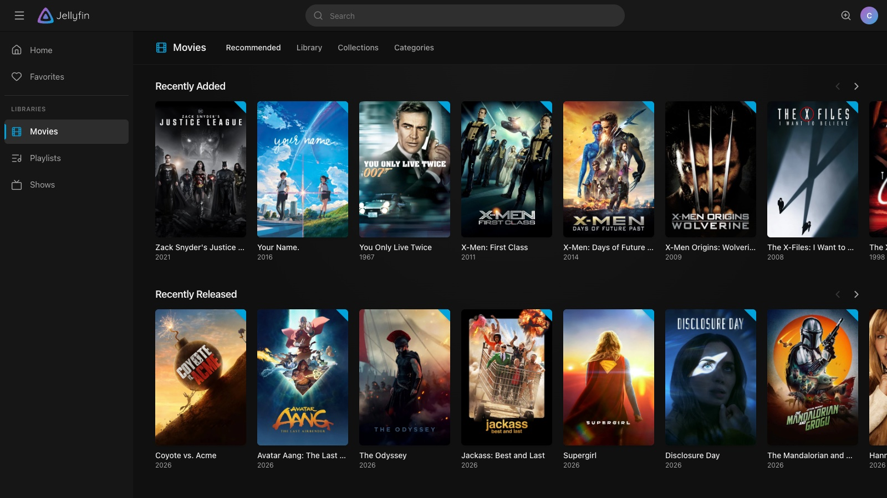
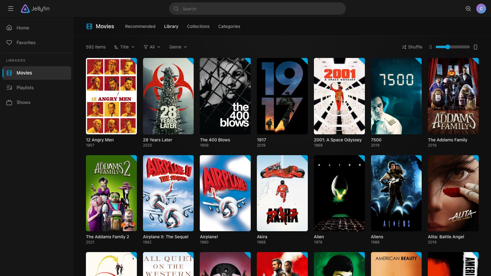
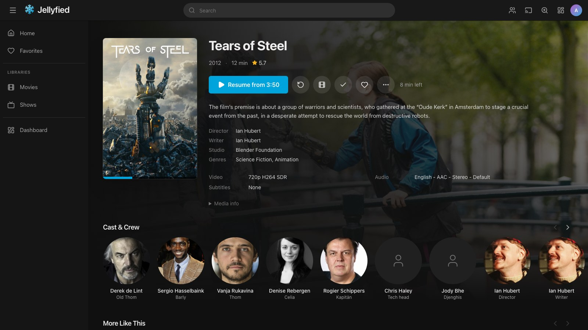
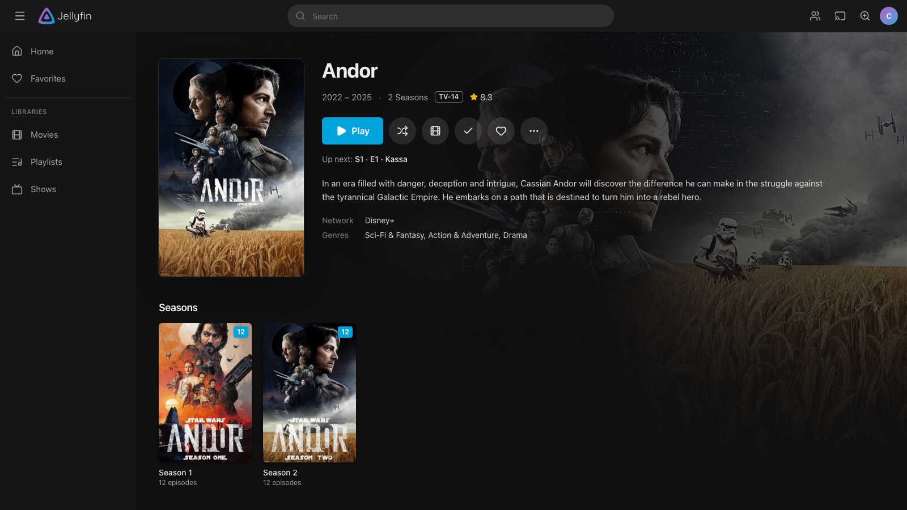
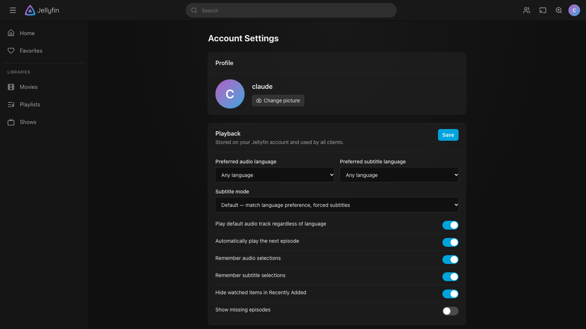

# Jellyplex

A web frontend for an existing [Jellyfin](https://jellyfin.org) server, with a layout modelled on Plex,
Jellyfin's own colour scheme and logo, and a full server dashboard for administrators. It runs as a
small nginx container. Your Jellyfin server is not modified: Jellyplex is just another client.



## Screenshots

| Library view | Movie details |
| --- | --- |
|  |  |

| Show details | Account settings |
| --- | --- |
|  |  |

## Features

**Browsing (Plex layout)**
- Top bar with global search (type `/` to focus) and live results, collapsible library sidebar, account menu.
- Drag libraries in the sidebar to reorder them. The order is saved to your Jellyfin account, so it
  also applies to the home page and other Jellyfin apps.
- Home: Continue Watching (in-progress plus next-up episodes merged, like Plex's On Deck),
  Continue Listening, and Recently Added per library.
- Libraries with Plex-style tabs: Recommended / Library / Collections / Categories for movies and TV,
  Albums / Artists / Genres for music, and folder browsing for home videos, photos, books and mixed libraries.
  Sorting, watched/unwatched/in-progress/favorite filters, genre filter and infinite scroll.
- Adjustable poster size on every page (top-bar zoom button, or the slider in library views). The
  setting applies to every row and grid and is remembered.
- Detail pages for movies, shows, seasons, episodes, albums, artists, playlists, collections, people,
  genres and studios. Backdrop hero, ratings, cast & crew, extras, trailers, "More Like This", and
  version/audio/subtitle pickers.
- Shuffle button on folder-based libraries and folder pages. It plays everything below the folder,
  including subfolders.
- Unwatched corner badges, progress bars, watched toggles and favorites everywhere.
- "Remove from Continue Watching" in the menu of anything you have started, to clear its resume
  position.
- Add movies, shows and videos to a collection (new or existing) from their menu, and remove them
  again on the collection's page. Needs administrator rights or the collection-management permission.
- Playlists: "Add to playlist" in the menu of songs, albums, artists, movies, shows and episodes
  (to a new or an existing playlist). On a playlist's page, drag entries into another order, remove
  them, rename the playlist, or make it visible to all users.

**Playback**
- Video player that plays files directly when the browser supports them and lets the server
  transcode when it doesn't, switching over automatically if direct play fails.
- Audio track, subtitle, quality and playback speed (0.5×–2×) switching. Text subtitles
  (SRT/ASS/VTT, embedded or sidecar) and image subtitles (PGS/VobSub) are both supported.
- Resume, chapter markers and a chapter list to jump from, thumbnail previews on the seek bar
  (when the server has generated trickplay images), Skip Intro / Credits (when the server has
  media segments), Up Next with auto-play (honours the user's preference), keyboard shortcuts.
- Subtitle delay (earlier or later in 0.1 s steps) and subtitle appearance (size, colour,
  background, edge) for text subtitles.
- Audio delay, to hold the sound back by up to 3 seconds when it is ahead of the picture. Both
  delays have a slider and step buttons in the player menus, as well as keyboard shortcuts.
- Aspect ratio and zoom: fit, fill (crop) or stretch the picture, force 16:9, 4:3, 21:9 or
  2.39:1, and zoom in up to 200%.
- Remembers the audio and subtitle track you pick for a show and uses it for the following
  episodes, matching by language and title, so it also works when episodes number their tracks
  differently. Follows the "Remember audio/subtitle selections" account settings.
- Playback info overlay ("stats for nerds"): play method, why the server is transcoding and what
  the transcoder is doing, source and player resolution, codecs, buffer and dropped frames.
- Sleep timer: pause after 15 to 120 minutes, or stop at the end of the current video.
- "Ends at" clock in the player controls, showing when the video will finish at the current
  playback speed.
- Picture-in-picture, from the player or the mini player, plus OS media controls (media keys,
  lock screen) for video.
- SyncPlay: create or join a group from the top bar and watch together. Play, pause, seek and
  moving on to the next episode apply to everyone, and playback is kept in step across devices.
- Play on another device: pick any Jellyfin app that supports remote control (TV apps, another
  browser tab, …) from the top bar, and what you play is sent there, with a remote-control bar for
  pause, seek, volume and stop. Jellyplex tabs can be controlled the same way from other apps.
- Mini player: press Back (or `Esc`) in the player and the video keeps playing in a small window,
  so you can browse and read media info while streaming. Click it to expand, or use its controls to
  pause or stop. Starting music pauses the video.
- Persistent music player bar with queue, shuffle, repeat and OS media keys.
- Instant Mix: start a queue of similar music from any song, album, artist, genre or playlist.
- Playback progress and watched state are synced with Jellyfin, so you can continue on any other
  Jellyfin app.

**Server dashboard (administrators)**
- Dashboard: active streams with transcode details and remote pause/stop/message, active devices,
  library counts, storage, running tasks, recent activity, scan/restart/shutdown.
- General settings, Users (create, delete, permissions, library access, passwords),
  Libraries (add with a server-side folder browser, rename, add/remove folders, scan, refresh metadata, remove),
  Transcoding (hardware acceleration, encoder settings, throttling, resume thresholds),
  Networking, Scheduled Tasks, Activity log, Devices, Plugins (installed and catalog, with a
  Configure link that opens the plugin's settings page in the Jellyfin web UI),
  API keys and a Log viewer.
- Metadata editor ("Edit metadata" in an item's menu): titles, overview, dates, ratings, genres,
  tags, studios and external IDs; upload, delete or find artwork online; and Identify to match an
  item against the server's metadata providers again.

**Account**
- Quick Connect sign-in and authorization, profile picture, password, playback language and subtitle
  preferences, and per-device settings for streaming quality, time display (24-hour by default,
  or 12-hour), subtitle appearance and interface colours (accent colour, from presets or any
  colour you pick, and background tone).

## Installation

Jellyplex needs a running Jellyfin server (10.9 or newer, 10.11 recommended) and Docker. You can
run the [prebuilt image](#prebuilt-image) or build the container from source with
[Docker Compose](#docker-compose).

### Prebuilt image

Images for amd64 and arm64 are published to the GitHub Container Registry:

```bash
docker run -d --name jellyplex -p 8080:80 \
  -e JELLYFIN_URL=http://192.168.1.10:8096 \
  --restart unless-stopped ghcr.io/charliegolfx/jellyplex:latest
```

Set `JELLYFIN_URL` to your Jellyfin server as reachable from inside the container (see the table
under [Docker Compose](#docker-compose)), then open `http://localhost:8080`.

| Tag      | Contents |
| -------- | -------- |
| `latest` | The newest release. |
| `1.2.3`, `1.2`, `1` | A specific release, or the newest one within that version line. |
| `edge`   | The current `main` branch. |

To update, pull the image again and recreate the container. What changed in each release is in
the [changelog](CHANGELOG.md).

### Docker Compose

This builds the container from source.

1. Clone the repository:

   ```bash
   git clone https://github.com/CharlieGolfX/jellyplex.git
   cd jellyplex
   ```

2. Tell Jellyplex where your Jellyfin server is. The default is a Jellyfin server on the Docker
   host, port 8096; if that is your setup, skip this step. Otherwise create a `.env` file from the
   example and set `JELLYFIN_URL` in it, to the address as reachable from inside the Jellyplex
   container:

   ```bash
   cp .env.example .env
   ```

   | Where Jellyfin runs                    | `JELLYFIN_URL`                                                         |
   | -------------------------------------- | ---------------------------------------------------------------------- |
   | Same Docker network / compose project  | `http://jellyfin:8096`                                                 |
   | On the Docker host                     | `http://host.docker.internal:8096`                                     |
   | Another machine                        | `http://192.168.1.10:8096`                                             |
   | Behind a base URL                      | `http://jellyfin:8096/jellyfin`                                        |

3. Build and start the container:

   ```bash
   docker compose up -d --build
   ```

4. Open `http://localhost:8080` and sign in with your Jellyfin account.

The port and the other settings are described under [Configuration](#configuration).

To update later, pull the latest changes and rebuild:

```bash
git pull
docker compose up -d --build
```

### Building with Docker, without Compose

```bash
git clone https://github.com/CharlieGolfX/jellyplex.git
cd jellyplex
docker build -t jellyplex .
docker run -d --name jellyplex -p 8080:80 \
  -e JELLYFIN_URL=http://192.168.1.10:8096 \
  --restart unless-stopped jellyplex
```

### Static hosting without Docker

`npm run build` produces a static site in `dist/`. Serve it with any web server that falls back to
`index.html` for unknown paths, and edit `dist/config.js` to point `serverUrl` at your Jellyfin
server. In this mode the browser talks to Jellyfin directly, which works because Jellyfin allows
cross-origin requests by default.

## Configuration

Jellyplex is configured with environment variables. With Docker Compose, set them in a `.env`
file next to `docker-compose.yml` (copy `.env.example`) or edit `docker-compose.yml` directly;
with plain `docker run`, pass them with `-e`. Changes take effect when the container is recreated.

| Variable                | Default                    | Description |
| ----------------------- | -------------------------- | ----------- |
| `JELLYFIN_URL`          | _(empty)_ ¹                | Jellyfin address seen from the container. Enables the built-in reverse proxy at `/jellyfin`, so the browser only ever talks to Jellyplex (no CORS or mixed-content problems, one URL to expose). |
| `JELLYFIN_PUBLIC_URL`   | _(empty)_                  | Address the browser should use to reach Jellyfin directly, e.g. `https://jellyfin.example.com`. Overrides the proxy for API and media requests. |
| `JELLYPLEX_LOCK_SERVER` | `true` if a server is set  | When `true`, users can't switch to a different server on the login screen. |
| `JELLYPLEX_PORT`        | `80`                       | Port nginx listens on inside the container. |

¹ The Compose file sets it to `http://host.docker.internal:8096` unless you choose another value.

If neither URL is set, the login screen asks for the server address. Jellyfin allows cross-origin
requests by default, so this works without a proxy too.

Docker Compose additionally understands these:

| Variable                 | Default    | Description |
| ------------------------ | ---------- | ----------- |
| `JELLYPLEX_HOST_PORT`    | `8080`     | Port Jellyplex is reachable on. |
| `JELLYPLEX_BIND_ADDRESS` | `0.0.0.0`  | Address the port is published on. Use `127.0.0.1` to make Jellyplex reachable from the Docker host only, for example when a reverse proxy runs in front of it. |

### Notes

- Real client IPs: in proxy mode Jellyfin sees requests coming from the Jellyplex container.
  To make Jellyfin trust the forwarded client address (used for LAN/remote detection and remote
  bitrate limits), add the Jellyplex container's IP or Docker subnet under
  *Dashboard → Networking → Known proxies*.
- HTTPS: put Jellyplex behind your usual reverse proxy (Traefik, Caddy, nginx, …) the same way
  you would any web app. In proxy mode, Jellyfin doesn't need to be exposed at all.
- The container serves a health check at `/healthz`.
- Jellyplex stores only its session token and UI preferences in the browser's local storage.

## Keyboard shortcuts (player)

| Key            | Action              |
| -------------- | ------------------- |
| `Space` / `K`  | Play / pause        |
| `←` / `J`      | Back 10 seconds     |
| `→` / `L`      | Forward 30 seconds  |
| `↑` / `↓`      | Volume              |
| `M`            | Mute                |
| `F`            | Full screen         |
| `N`            | Next item           |
| `P`            | Picture-in-picture  |
| `<` / `>`      | Slower / faster     |
| `G` / `H`      | Subtitles earlier / later |
| `Z` / `X`      | Less / more audio delay |
| `I`            | Playback info       |
| `Esc`          | Close menu / minimize to mini player |

`/` focuses search anywhere in the app.

## Development

Requires Node.js 22.22+ (24 recommended).

```bash
npm install
cp .env.example .env          # set JELLYFIN_URL to your Jellyfin server
npm run dev                   # http://localhost:5173
npm run build                 # type-check and production build into dist/
npm run check                 # lint, type-check and unit tests
npm run test:e2e              # browser tests (first run: npx playwright install chromium)
```

The development server proxies `/jellyfin` to `JELLYFIN_URL`, like the container does. Set
`JELLYFIN_DEV_URL` if your machine reaches Jellyfin at a different address than the container,
and `JELLYPLEX_DEV_PORT` to use a port other than 5173.

Stack: React 19, TypeScript, Vite, Tailwind CSS 4, TanStack Query, React Router and hls.js.
The Jellyfin API client is a thin typed `fetch` wrapper (`src/api/`).

### Tests

- **Unit tests** ([Vitest](https://vitest.dev)) live next to the code as `*.test.ts(x)`. `npm test`
  runs them once, `npm run test:watch` re-runs them as you edit.
- **Browser tests** ([Playwright](https://playwright.dev)) are in `e2e/`. `npm run test:e2e` builds
  the site and runs `smoke.spec.ts` against a mocked Jellyfin API, so no server is needed.
- **Playback tests** (`e2e/live.spec.ts`) play real media and are skipped unless you give them a
  test account. They change the watched state of what they play, so use a throwaway user:

  ```bash
  E2E_USERNAME=test E2E_PASSWORD=secret E2E_JELLYFIN_URL=http://localhost:8096 npm run test:e2e
  ```

  Add `E2E_BASE_URL=http://localhost:8080` to test a running container instead of a fresh build.
- **Linting** uses [oxlint](https://oxc.rs/docs/guide/usage/linter) (`npm run lint`), including the
  React hooks rules. Errors fail the build; warnings mark code that is worth a second look.

GitHub Actions runs all of this, and a build of the container, on every push and pull request.

### Releasing

1. Set the new version in `package.json` (`npm version --no-git-tag-version 1.2.3`) and move the
   "Unreleased" entries in `CHANGELOG.md` under it.
2. Commit, then tag the commit `v1.2.3` and push the tag. The tag has to match `package.json`.

The "Container image" workflow then publishes `ghcr.io/charliegolfx/jellyplex` with that version
and `latest`. Every push to `main` publishes `edge`.

```
src/
  api/          API client, types, image helpers, React Query hooks
  auth/         session handling
  components/   layout (top bar, sidebar, search), media cards and hubs, UI primitives
  pages/        home, library, item details, search, favorites, settings, admin/*
  player/       video player, device profile, music player, playback reporting,
                SyncPlay, remote control
  player/video/ parts of the video player: stream handling, menus, shortcuts
  realtime/     WebSocket connection to the server
e2e/            browser tests
docker/         container entrypoint that writes config.js and the nginx site
```

## Compatibility and limitations

- Jellyfin 10.11 is recommended and is what Jellyplex is tested against. Jellyfin 10.9 and 10.10
  are expected to work, with a few features unavailable: storage statistics need 10.11 and Skip
  Intro needs 10.10 or newer. Seek-bar previews only appear for videos with trickplay images.
- Server-side plugins work as usual. Plugins that modify the Jellyfin web UI have no effect in
  Jellyplex, and plugin settings pages open in the Jellyfin web UI.
- Not implemented: Live TV / DVR and the photo slideshow (single-photo viewer only). Use the
  regular Jellyfin web UI for those.
- "Play on another device" works with apps that are signed in to your Jellyfin server and accept
  remote control. Casting straight to a Chromecast or AirPlay device that isn't running a Jellyfin
  app is not supported.
- SyncPlay covers video. Music played while in a group stays on your own device.
- Subtitle delay and appearance apply to text subtitles. Image subtitles are burned into the video
  by the server and can't be adjusted.
- Audio delay can only make the sound later, not earlier: a browser can't play sound ahead of the
  picture. It is not available in Safari on iPhone and iPad.
- The remembered track per show and the interface colours are stored in the browser, so they
  don't follow you to other devices.
- SyncPlay and remote control use a WebSocket connection. If you put another reverse proxy in front
  of Jellyplex, make sure it forwards WebSocket upgrades.
- Which formats play directly depends on the browser. Jellyplex tells the server exactly what the
  current browser can decode, and the server transcodes everything else.

## Contributing

Bug reports, feature requests and pull requests are welcome.

- **Bugs:** open an issue and include your Jellyplex version (shown in the account menu), your
  Jellyfin server version, the browser you use, and the steps
  to reproduce the problem. For playback problems, also say whether the player showed direct play
  or transcode, and include the media info for the file if you can.
- **Features:** open an issue to discuss larger changes before you start, so we can agree on the
  approach first.
- **Pull requests:**
  1. Fork the repository and create a branch from `main`.
  2. Set up the development environment as described under [Development](#development).
  3. Keep each pull request focused on one change, and follow the existing code style.
  4. Run `npm run check` and `npm run build` before you submit. Both must pass, and new logic
     should come with a test.
  5. Describe what you changed and how you tested it. For UI changes, add a screenshot.

By submitting a contribution you agree that it is licensed under the GPLv2, the same license as the
rest of the project.

## Credits

The Jellyfin logo and colour scheme (purple `#AA5CC3` → blue `#00A4DC`) come from
[jellyfin/jellyfin-ux](https://github.com/jellyfin/jellyfin-ux). All copyright in that artwork belongs
to the Jellyfin contributors, and it is licensed under
[CC BY-SA 4.0](https://creativecommons.org/licenses/by-sa/4.0/). Jellyplex is an unofficial client
and is not affiliated with or endorsed by the Jellyfin project.

## License

Jellyplex is licensed under the [GNU General Public License v2.0](LICENSE). The Jellyfin artwork
mentioned under [Credits](#credits) keeps its own CC BY-SA 4.0 license.
